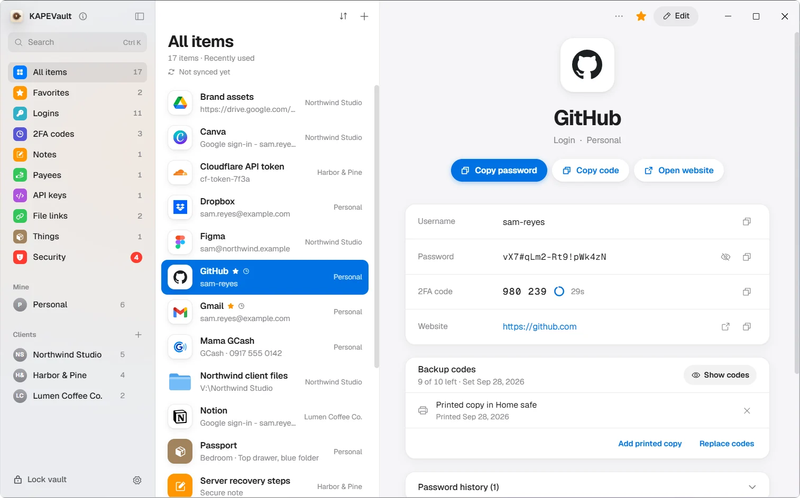
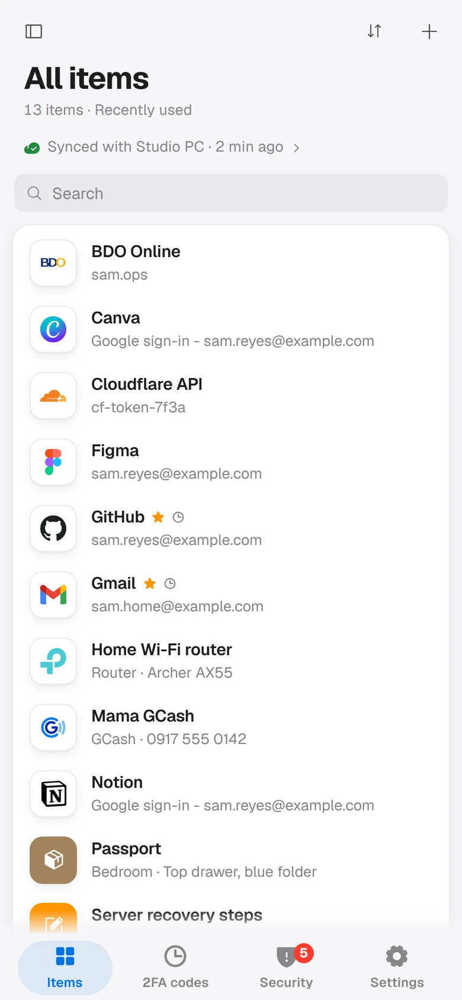
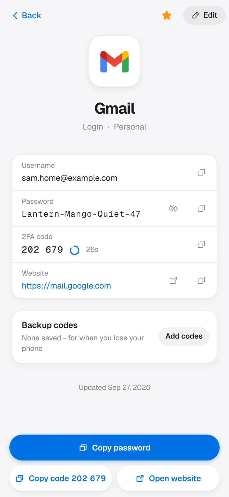
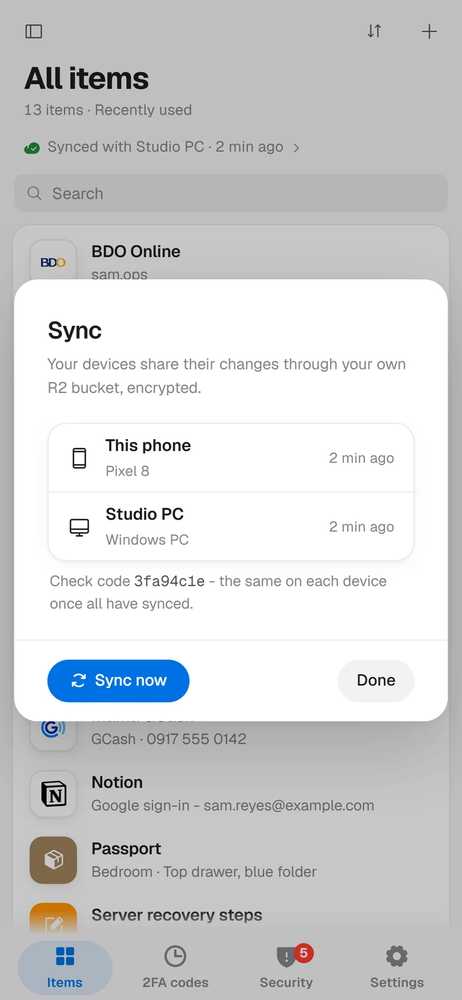
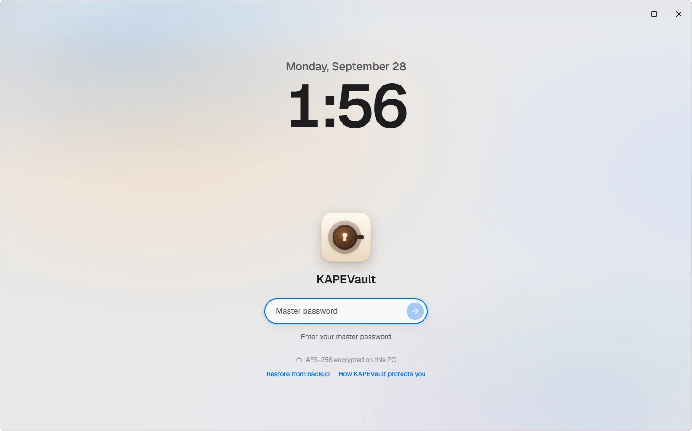
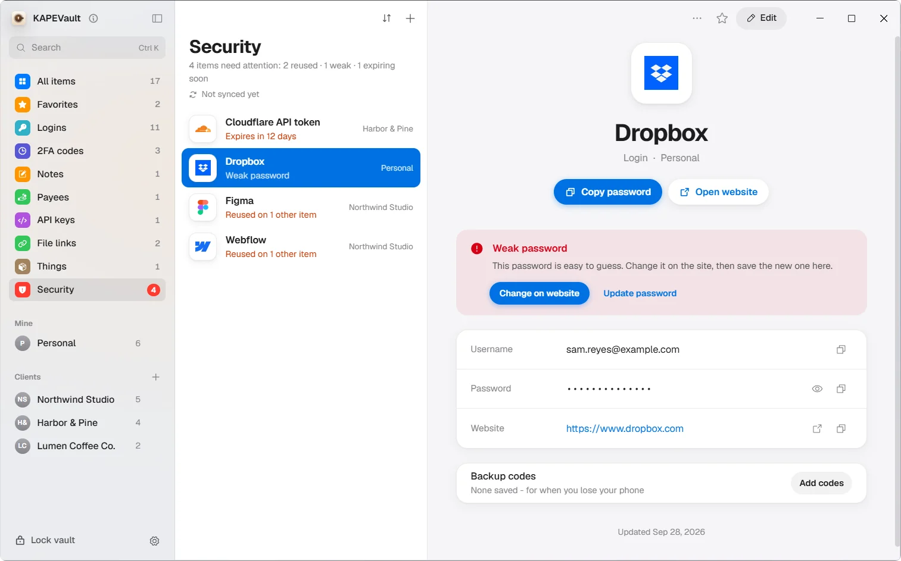
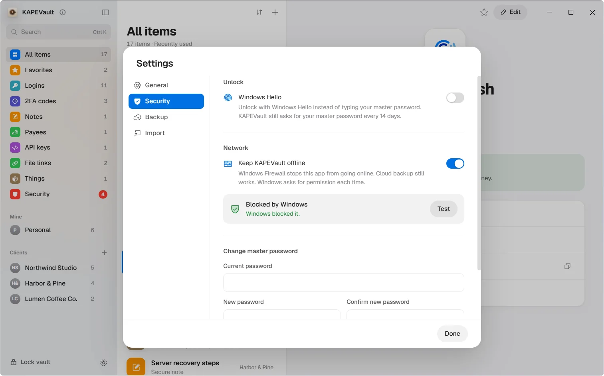
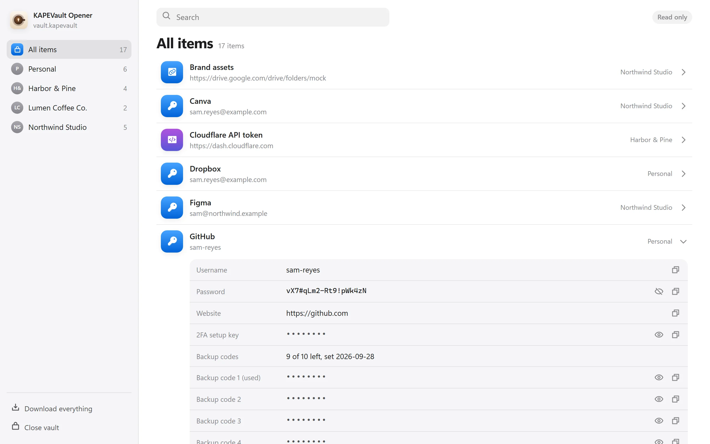

# KAPEVault

An encrypted password vault for Windows and Android that keeps everything on your own devices.
There is no KAPEVault account and no KAPEVault server.

It stores logins (including Sign in with Google logins), 2FA codes, IDs, secure notes, API keys,
devices, things and links to files and folders, all in one encrypted file. On Windows it
imports from Bitwarden, 1Password, KeePass, Chrome, Edge, Brave, Firefox, Apple Passwords and LastPass
exports. On both apps a deleted item goes to the Trash for 30 days, with Undo.

Website and docs: https://kapevault.brewedops.cloud

<picture>
  <source media="(prefers-color-scheme: dark)" srcset="docs/screenshots/pc-main-dark.webp">
  
</picture>

On Android: your items, one login with its 2FA code, and, with KAPEVault Pro (a one-time Google Play
purchase), sync with your PC through your own bucket. Pro is checked by the app alone, with no server,
and the source is GPL: anyone can build it with Pro unlocked. Buying it supports the project. A build
without Google Play code (F-Droid, or building it yourself with `npm run apk:release:foss` in `mobile/`)
cannot buy Pro.

<p>
  <picture>
    <source media="(prefers-color-scheme: dark)" srcset="docs/screenshots/phone-home-dark.webp">
    
  </picture>
  <picture>
    <source media="(prefers-color-scheme: dark)" srcset="docs/screenshots/phone-detail-dark.webp">
    
  </picture>
  
</p>

## How it protects your vault

- Your master password becomes a key through **scrypt** (N=2^17, r=8, p=1), and **AES-256-GCM** seals the
  whole vault as one file on your device. The master password is never stored.
- Every file is checked before any key is derived: a vault or backup with other scrypt settings is
  refused, so a planted file cannot hang unlock.
- On Windows, the unlocked vault and its key live only in the app's main process; the window only sees
  an item's password when you reveal, copy or edit it. On Android, the vault and its key live in the
  app's page, behind one vault-host module the screens ask for one secret at a time (no separate process).
- On Windows, copied passwords clear from the clipboard after 30 seconds, on lock and on quit, and are
  kept out of clipboard history. On Android, a copy is marked sensitive and cleared within 30-60 seconds
  and on lock.
- It locks itself after 5 minutes without keyboard or mouse use, on sleep and on Windows lock (on the
  phone: 30 seconds after you leave the app by default - at once, 30 seconds or 1 minute in Settings),
  and on both 8 hours after unlock by default.
- Nothing readable ever leaves your device, and KAPEVault's own code has no telemetry and no remote
  calls. There are four exceptions, all started by you:
  - the optional backup and sync: the already encrypted vault file (plus the Forever Opener page, which
    holds no vault data) goes to a Cloudflare R2 bucket **you** own;
  - on Android, Google Play for KAPEVault Pro (phone-PC sync and client folders; everything else is free),
    only after you opened the Pro sheet, tapped Buy or Restore purchase, or while the app's record says a
    purchase is bought or pending. Nothing from your vault goes. Once that billing code has run, Google's
    Play Billing library may send Google its own diagnostic logs (its datatransport job, uploaded later by
    Android's scheduler). KAPEVault's own code sends no telemetry, and a free user who never opens Pro
    never runs it;
  - on Windows, the update check (Settings > General > Check for updates, off until you switch it on):
    once a day one HTTPS request to GitHub's public release list. GitHub sees your IP address; the request
    carries no cookie, install id or vault data, and only the newest release's version is read;
  - on Windows, the Test button of Air Wall opens one TCP connection to 1.1.1.1 port 443, only when you
    press it, to see whether Windows blocks it. It sends nothing over it.

  A link you click opens in your own browser.
- **Air Wall** (Windows) has Windows Firewall block the app from the internet. Encrypted backups, and the
  update check if you turned it on, still go through.
- The **Forever Opener** is one HTML file that opens your vault in any browser, offline, without KAPEVault.
- An **Emergency Kit** is a printable page with everything needed to recover.

<table>
  <tr>
    <td width="50%">
      <picture>
        <source media="(prefers-color-scheme: dark)" srcset="docs/screenshots/pc-lock-dark.webp">
        
      </picture>
      <br><b>Lock screen.</b> The master password unlocks the vault on this PC.
    </td>
    <td width="50%">
      
      <br><b>Security check.</b> Weak, reused and expiring items, with a way to fix each.
    </td>
  </tr>
  <tr>
    <td width="50%">
      
      <br><b>Air Wall.</b> Windows Firewall keeps the app offline, and a test proves it.
    </td>
    <td width="50%">
      
      <br><b>Forever Opener.</b> Your vault in any browser, offline, read-only.
    </td>
  </tr>
</table>

The file format is in [FORMAT.md](FORMAT.md) and the backup and phone sync design in [SYNC.md](SYNC.md).

## Command line

`cli/kapevault.cjs` reads and edits the vault from a terminal. Its commands and flags follow the
1Password `op` CLI, so `op://` references and `.env` files written for `op` work unchanged.
`kapevault://` references work too.

Run it with `node cli/kapevault.cjs` from a checkout. After `npm link`, run it as `kapevault` or
`npx kapevault`. Run `node cli/kapevault.cjs --help` to see all commands.

It opens `vault.kapevault` in the app's data folder: `%APPDATA%\KAPEVault` on Windows,
`~/Library/Application Support/KAPEVault` on macOS, and `~/.config/KAPEVault` on Linux. Set
`KAPEVAULT_DATA_DIR` or pass `--data-dir` to use another folder.

Each command unlocks the vault with your master password. It does not keep a session. The password
comes from the first of these that is set:

1. `--password-stdin`: one line on stdin.
2. The `KAPEVAULT_MASTER` environment variable. It does the job of `OP_SERVICE_ACCOUNT_TOKEN`.
3. A prompt, when stdin is a terminal.

Wrong passwords count against the same unlock throttle as the app. `run` removes `KAPEVAULT_MASTER`
from the environment of the command it starts.

```sh
kapevault item get GitHub --fields username,password --reveal
kapevault read "op://Personal/GitHub/password"
echo 'DB_PASSWORD={{ op://Personal/Postgres/password }}' | kapevault inject -o .env
DB_PASSWORD=op://Personal/Postgres/password kapevault run -- node server.js
```

`run` replaces each secret in the command's output with `<concealed by KAPEVault>`. Pass
`--no-masking` to turn this off.

Quit the desktop app before a command that writes (`item create`, `item edit`, `item delete`,
`item move`, `vault create`, `vault edit`). The app saves the vault it holds in memory over the file,
so a change made while it runs is lost. These commands stop with an error while the app is open.
Commands that only read work while the app is open.

## Security

- What KAPEVault defends against, and where it stops: [docs/THREAT-MODEL.md](docs/THREAT-MODEL.md).
- How to report a problem (privately): [SECURITY.md](SECURITY.md).
- The last full self-review (a historical snapshot, with every fix): [SECURITY-AUDIT-2026-09-28.md](SECURITY-AUDIT-2026-09-28.md).
  KAPEVault has not had a third-party audit.

## Updates and security notices

Only the latest release is supported. The Windows app can tell you when one is out (Settings > General >
Check for updates, off by default); the Android app does not check. To hear about a new release, or a
security fix, **watch the repository** on GitHub
(Watch > Custom > Releases, and Security alerts) or follow its
[Security advisories](https://github.com/brewed-ops/kapevault/security/advisories) and
[Releases](https://github.com/brewed-ops/kapevault/releases) pages. The website,
https://kapevault.brewedops.cloud, is the other place to look. A Windows update is a new installer run over the old one: it
keeps your vault. On Android, install the new APK over the old one, or update from Google Play if that is where
you got it.

## Verify a download

Check the SHA-256 and the build provenance of a Windows installer, and the SHA-256 and signing
certificate of an Android APK, before you install it: [RELEASING.md](RELEASING.md#verify-a-download).
Windows installers are built by a GitHub Actions workflow from a public tag of this repository, and
`gh attestation verify` proves it. The Windows installer is unsigned until code signing is approved, so
Windows SmartScreen warns about it.

## Remove KAPEVault completely

Uninstalling removes the program and **keeps your vault on purpose**, so a reinstall opens it again. To
leave nothing behind (a PC you hand on, or you are done with it):

1. **Before you uninstall**, in KAPEVault: Settings > Security, turn **Keep KAPEVault offline** (Air Wall)
   off, which removes its Windows Firewall rule (Windows asks for permission once), and turn **Windows
   Hello** off, which deletes the Hello key and its file. In Settings > General, turn **Start with Windows**
   off. Copy your vault somewhere safe first if you still want it.
2. Uninstall: Windows Settings > Apps > Installed apps > KAPEVault > Uninstall.
3. Delete the data folder `%APPDATA%\KAPEVault`. Back up `vault.kapevault` first if you want to keep it.
   What is in it:
   - `vault.kapevault`: your encrypted vault;
   - `replaced.kapevault` and `replaced-next.kapevault`: the copy a restore replaced, and a restore being
     staged (encrypted, same format);
   - `hello.json`: the vault key wrapped by Windows Hello (`touchid.json` on a Mac);
   - `settings.json`: window size and place, theme, lock settings;
   - `sent-snapshots.json`: which backups this PC uploaded;
   - `unlock-throttle.json`: the wrong-password counter;
   - the folders Chromium keeps for any app (cache, local storage and the like), which hold no vault data.
4. Copies you made yourself are not in that folder: backups in your R2 bucket, a folder copy you chose,
   saved `KAPEVault Opener.html` pages, Emergency Kits and Hand back PDFs. Delete those too.

If you uninstalled without turning Air Wall off, the firewall rule stays (a normal uninstall cannot remove
a rule added with administrator rights). Remove it from an administrator Command Prompt:

```
netsh advfirewall firewall delete rule name="KAPEVault Air Wall"
```

A Windows Hello key named "KAPEVault" left in Windows' Hello store opens nothing without `hello.json`. To
delete it too, reinstall KAPEVault and turn Windows Hello off there before uninstalling. On Android, uninstalling the app deletes
its vault (the phone has no copy outside the app): back it up or sync it first.

## What KAPEVault does not do

- No account, no server, no telemetry. Backups go only to an R2 bucket you own; the one other call is the
  update check, which is off until you turn it on.
- No browser extension. On Windows, Quick Search (Ctrl+Shift+Space) finds an item and copies from it;
  on Android, the system autofill service fills apps and browsers.
- No passkeys yet.
- No breach check. Nothing about your passwords is sent anywhere to look them up.
- No plaintext or CSV export. The way out is the encrypted vault file, its spec in
  [FORMAT.md](FORMAT.md), and the Forever Opener, which reads it in any browser. The only plaintext the
  app writes is a printable PDF you ask for (Hand back, Emergency Kit).
- No import of 1Password's 1PUX format; use its CSV export. Import is on Windows only.
- The Trash keeps a deleted item for 30 days, then deletes it for good.

## Build from source

Requirements: Node (the version in [.nvmrc](.nvmrc)) and npm. The Windows app builds on Windows; the
Android app needs the Android SDK and JDK 21.

```sh
npm ci
npm start            # build and open the desktop app
npm run app:dev      # the desktop app with hot reload
npm test             # unit tests for core/, electron/ and src/ (crypto, vault file, sync, rules)
npm run e2e          # drives every screen of the real app window against a throwaway vault
npm run installer    # the Windows installer
```

`npm test` does not cover the Android app; run `cd mobile && npm ci && npm test` for that.

`npm run e2e` opens the real app window, so it needs a desktop session and does not run in CI. It
needs Playwright, which is not a dependency: `npm i -D playwright && npx playwright install chromium`,
or set `PLAYWRIGHT_PATH` to a playwright package folder.

The Android app lives in [mobile/](mobile/) with its own `package.json`; see [mobile/README.md](mobile/README.md).

## Layout

| Folder | What it is |
|---|---|
| `core/` | The rules both apps share: the vault format, sync merge, validation, item kinds |
| `electron/` | The desktop app's main process: encryption, the unlocked session, backup, OS features |
| `src/` | The desktop app's window (React), in feature folders under `src/features/` |
| `mobile/` | The Android app (Capacitor): its own UI, the native autofill service, the phone's vault host |
| `scripts/` | Build, test and release scripts |

## Licence

KAPEVault is free software: you can redistribute it and/or modify it under the terms of the
[GNU General Public License, version 3](LICENSE) (3 only). Copyright (C) 2026 BrewedOps.

The Android app also links Google's Play Billing and Play services libraries (for KAPEVault Pro), which are
not free software. [LICENSE-EXCEPTION](LICENSE-EXCEPTION) is the extra permission that makes that allowed,
and [NOTICE](NOTICE) names the libraries. A build without Google Play Billing: see
[mobile/README.md](mobile/README.md).

Brand logos in `src/assets/logos/` and `mobile/` are trademarks of their owners. They are shown only to
help you recognise your own accounts and are not covered by this licence.
